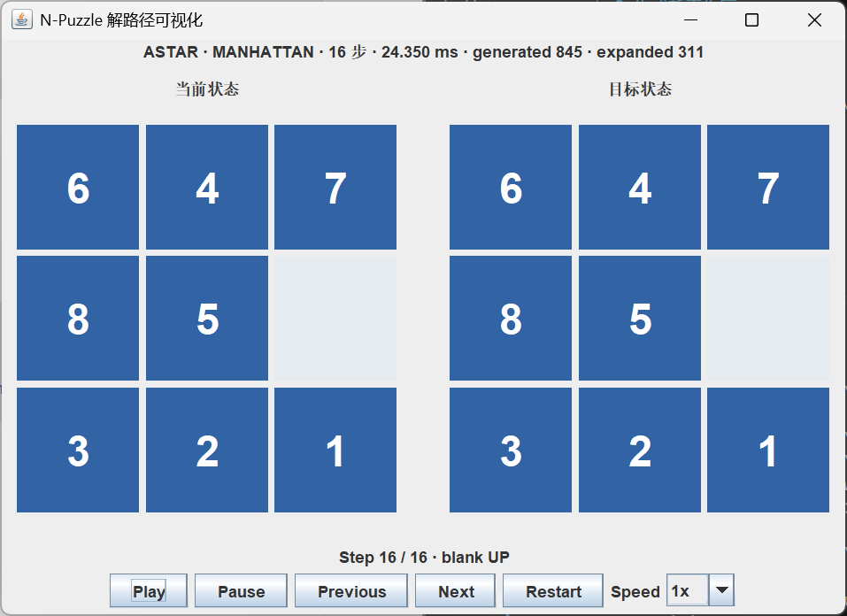
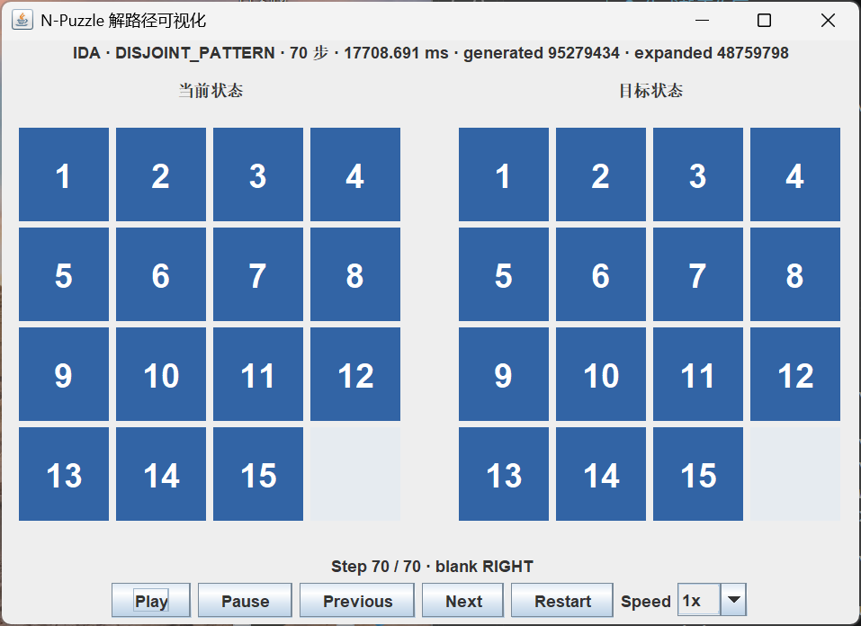

# WattAi · N-Puzzle

人工智能实验一：在教师 Java 框架上实现 A*、IDA*、加性 PDB 和 Swing 解路径播放。教师框架、示例和原题的 31 个保护文件已恢复原始字节，扩展与兼容适配放在学生代码中。

[研究报告 DOCX](report/NPuzzle研究报告.docx) · [PDF](report/NPuzzle研究报告.pdf) · [逐项验收](docs/acceptance.md) · [原始结果索引](results/INDEX.md) · [教师合规](docs/teacher_compliance.md) · [变更与回退](docs/changes.md)

## 四阶段结果（2026-10-11 最终复核）

| 阶段 | 实现与结果 | 限制 |
| --- | --- | --- |
| 1：A* | PriorityQueue + 状态索引；教师 3×3 任意目标，独立 BFS 与 A* 均为最短 16 步；Misplaced/Manhattan 各三次搜索最大 28.752ms | 工作 JVM 内搜索与父端总时长分开计；不能外推所有题 |
| 2：IDA* | f 阈值、路径去环、TT/Zobrist 碰撞回归；原题索引3同题对照成功配置52步 | Misplaced 的 A*/IDA* 都在10秒限制下 TIMEOUT；教师第二阶段实例表述的歧义见合规文档 |
| 3：加性 PDB | hard 原题索引9，BASIC / 555T / fast=true，新冷缓存70步，父端22.729秒 | 建库计入总时长；1024m是堆上限；保留历史32.594秒及失败依据 |
| 4：可视化 | 文件驱动 Swing，3×3/4×4 初终态、异常输入及代表性交互截图已归档 | **2026-10-12 本机 GUI 人工验收通过**；截图为静态证据，速度差异依用户实际操作确认 |

不含本地教师资料、旧构建和缓存的干净快照完成 Java19 编译；六套测试共 227,250 项检查、两个新增回归、诊断工具和教师/学生双入口均通过。原始数据、哈希和全部保留路径的审查见 [最终证据](results/final-20261011/verification.json)。完整报告17页，封面身份与学期为 `待填写`。

## 构建与复现

Windows PowerShell，JDK19或更高版本；本轮实际使用 Java19。编译以 `--release 19` 固定兼容性，只在忽略的构建目录将教师混合 GBK/UTF8 源码转为 UTF8，不修改原件。

```powershell
# 编译并执行六套测试和两个新增回归
powershell -NoProfile -ExecutionPolicy Bypass -File tools/reproduce.ps1
# 独立冷缓存 hard + 同源缓存 warm；CSV状态、路径与实际父端时限均须通过
powershell -NoProfile -ExecutionPolicy Bypass -File tools/reproduce.ps1 -RunHard -RunWarm
# 有界同题对照：3×3每组3次，普通4×4每组1次
powershell -NoProfile -ExecutionPolicy Bypass -File tools/compare.ps1
# 验证报告数据哈希、31项教师字节、CSV/路径及本地导航
python tools/verify_project.py --classes build-test
```

输出采用新运行目录。未 SOLVED、错题、非法路径或实际父端超限会使 hard 复现入口失败；工作进程退出0本身不构成验收。教师原版 `core.runner.SearchTester` 保留，第二阶段入口为学生 `stud.g01.runner.StudentSearchTester`。

## 代表性比较

下表为2026-10-10同题数据；3×3取三次搜索中位数，4×4为单次。完整三启发函数与IDA*对照见[报告](report/NPuzzle研究报告.pdf)，失败行保留，不参与成功中位数。

| 实例/算法 | Misplaced ms | Manhattan ms | 加性 PDB ms | 最短步数 |
| --- | --- | --- | --- | --- |
| 教师3×3 A* | 23.750 | 24.350 | 21.692 | 16 |
| 教师3×3 IDA* | 134.892 | 121.195 | 107.974 | 16 |
| 原题索引3 4×4 A* | TIMEOUT（10s） | 1031.040 | 406.016 | 52 |
| 原题索引3 4×4 IDA* | TIMEOUT（10s） | 435.977 | 370.395 | 52 |

PDB准备时间另计，节点少不等于端到端最快；该有限样本不能证明全部15-Puzzle的性能排序。

## hard 真实性能

原题 `resources/problems3.txt` 第10行、零起索引9。Java19 / Intel i5-14500HX / Windows 10.0.26200 / `-Xmx1024m` / 60秒工作进程限制。

| 缓存 | 状态/步数 | 建库 ms | 加载 ms | 搜索 ms | 父端总 ms |
| --- | --- | --- | --- | --- | --- |
| 2026-10-11独立冷缓存 | SOLVED / 70 | 4819 | 0 | 17708.691 | 22729.4068 |
| 同源热缓存 | SOLVED / 70 | 0 | 29 | 20069.836 | 20301.7694 |

[最新冷记录与环境](results/run-20261011T071242033Z/) · [同源热记录](results/run-20261011T071242033Z-warm/) · [同题比较](results/compare-20261010T061625055Z/comparison.csv)

父端包含工作 JVM 启动、准备、搜索、回放与导出；父 JVM 自身首次启动未单独量测，差值不是纯启动耗时。历史冷缓存32.594秒和34.097秒仍可访问；本次搜索源码与节点数相同，耗时差异不能归因于文件整理。

## 本机 GUI 运行截图（2026-10-12）

以下为本机 Swing 窗口的**原始截图**，同一实例只展示一次初态与终态。点击图片可查看大图。

| 状态 | 教师指定 3×3：A* / Manhattan，16 步 | 最难 4×4：IDA* / Disjoint PDB，70 步 |
|:---:|:---:|:---:|
| **初始 Step 0** | [](docs/images/gui_3x3_initial.png) | [](docs/images/gui_4x4_initial.png) |
| **到达目标** | [](docs/images/gui_3x3_final.png) | [](docs/images/gui_4x4_final.png) |

两组图片的初态与目标均与原题一致，终态与目标相同。另有[不完整路径文件被拒绝的真实终端截图](docs/images/invalid_trace_rejected.png)，报错 `java.io.IOException: Incomplete solution file` 属于预期的负面测试。2026-10-12 用户在 Windows 本机确认 3×3/4×4 的 Play、Pause、Previous、Next、Restart、首末步边界及 0.5x/1x/2x 操作均正常；[精选 7 张按钮/速度静态证据与完整验收范围](docs/acceptance.md)。静态图片证明所示状态，不提供帧率或延迟的精确测量。

**报告一致性说明**：研究报告 DOCX/PDF 已嵌入 2026-10-10 的两张旧终态截图，其原文件及哈希保持不变；这里改用 2026-10-12 的四张完整窗口截图作为 README 唯一的 GUI 画面展示，避免重复展示旧图。正式报告目前没有重新生成。

## 路径播放与目录

```powershell
powershell -NoProfile -ExecutionPolicy Bypass -File tools/compile.ps1
java -cp build-test stud.g01.visual.PuzzleVisualizer results/solutions/2026-10-11T07-12-42.170991500Z-problems3_10-IDA-DISJOINT_PATTERN.tsv
```

按 [人工检查清单](docs/acceptance.md) 验收按钮与速度，填写报告封面。命令行 `--validate 路径.tsv` 可只做解析/合法性检查，不代表人工界面验收。

| 目录 | 内容 |
| --- | --- |
| src/core、src/algs4、原示例 | 保持教师参照字节；第三方声明保留 |
| src/stud/g01、src/stud/solver | 学生实现、扩展接口与原框架兼容适配 |
| tests、tools | 正确性回归、混合编码构建、有界复现/对照与报告生成 |
| resources | 原题与独立命名的教师3×3夹具 |
| results、docs、report | 原始证据、集中审查与完整可编辑报告 |
| teacher_reference、generated、build-* | 本地只读参考、再生缓存与构建产物，均不上传 |

最终成果统一到 main，仓库继续保持 private。教师参考目录、原 DOCX/PDF/ZIP、IDE/cache 与本地会话归档不上传；报告封面采用本地教师模板。私有归档不代表教师公开授权。原 `algs4` 版权及许可见 [THIRD_PARTY_NOTICES](THIRD_PARTY_NOTICES.md)。
