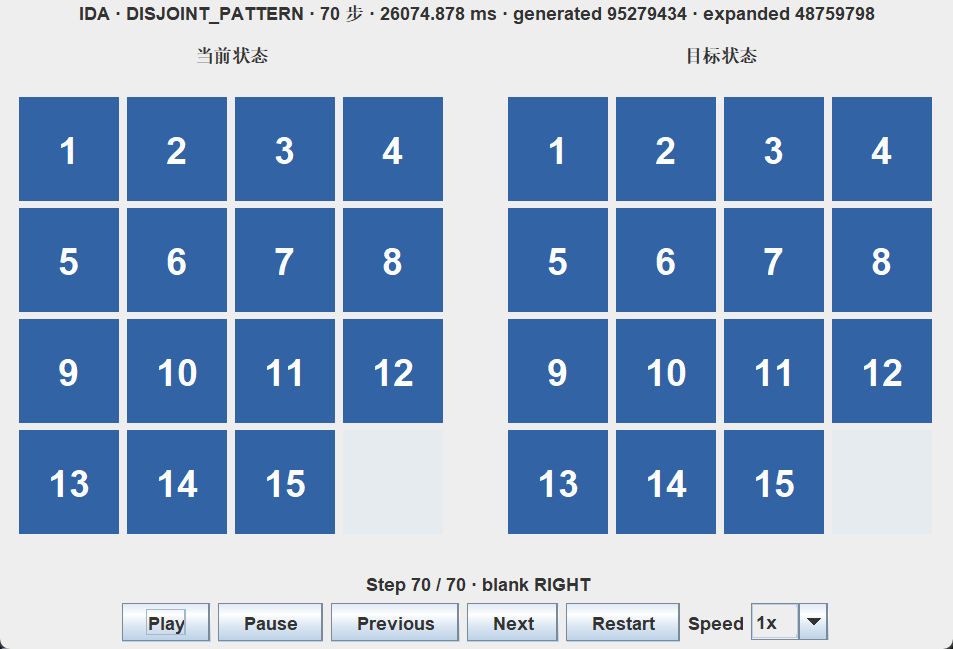

# WattAi · N-Puzzle

人工智能实验一：在教师 Java 框架上实现 A*、IDA*、加性 PDB 和 Swing 解路径播放。教师框架、示例和原题的 31 个保护文件已恢复原始字节，扩展与兼容适配放在学生代码中。

[研究报告 DOCX](report/NPuzzle研究报告.docx) · [PDF](report/NPuzzle研究报告.pdf) · [逐项验收](docs/acceptance.md) · [原始结果索引](results/INDEX.md) · [教师合规](docs/teacher_compliance.md) · [变更与回退](docs/changes.md)

## 四阶段结果（2026-10-10 本机实测）

| 阶段 | 实现与结果 | 限制 |
| --- | --- | --- |
| 1：A* | PriorityQueue + 状态索引；教师 3×3 任意目标，独立 BFS 与 A* 均为最短 16 步；Misplaced/Manhattan 各三次搜索最大 28.752ms | 工作 JVM 内搜索与父端总时长分开计；不能外推所有题 |
| 2：IDA* | f 阈值、路径去环、TT/Zobrist 碰撞回归；原题索引3同题对照成功配置52步 | Misplaced 的 A*/IDA* 都在10秒限制下 TIMEOUT；教师第二阶段实例表述的歧义见合规文档 |
| 3：加性 PDB | hard 原题索引9，BASIC / 555T / fast=true，独立冷缓存70步，父端32.594秒 | 建库计入总时长；1024m堆上限不是实际峰值；保留历史 TIMEOUT/OOM/FAIL |
| 4：可视化 | 文件驱动 Swing，3×3/4×4路径、播放状态、边界与速度自动测试通过 | **MANUAL_GUI_PENDING**；尚无实际按钮验收或截图 |

六套原有测试合计 227,250 个检查再次 PASS，两个新增回归通过。62份 CSV 的结构/路径引用与55条实际解路径已核验。完整报告15页，封面身份与学期为 `待填写`。

## 构建与复现

Windows PowerShell，JDK19或更高版本；本轮实际使用 Java19。编译以 `--release 19` 固定兼容性，只在忽略的构建目录将教师混合 GBK/UTF8 源码转为 UTF8，不修改原件。

```powershell
# 编译并执行六套测试和两个新增回归
powershell -NoProfile -ExecutionPolicy Bypass -File tools/reproduce.ps1
# 独立冷缓存 hard + 同源缓存 warm；CSV状态、路径与实际父端时限均须通过
powershell -NoProfile -ExecutionPolicy Bypass -File tools/reproduce.ps1 -RunHard -RunWarm
# 有界同题对照：3×3每组3次，普通4×4每组1次
powershell -NoProfile -ExecutionPolicy Bypass -File tools/compare.ps1
```

输出采用新运行目录。未 SOLVED、错题、非法路径或实际父端超限会使 hard 复现入口失败；工作进程退出0本身不构成验收。教师原版 `core.runner.SearchTester` 保留，第二阶段入口为学生 `stud.g01.runner.StudentSearchTester`。

## hard 真实性能

原题 `resources/problems3.txt` 第10行、零起索引9。Java19 / Intel i5-14500HX / Windows 10.0.26200 / `-Xmx1024m` / 60秒工作进程限制。

| 缓存 | 状态/步数 | 建库 ms | 加载 ms | 搜索 ms | 父端总 ms |
| --- | --- | --- | --- | --- | --- |
| 独立冷缓存 | SOLVED / 70 | 6192 | 0 | 26074.878 | 32593.8569 |
| 热缓存 | SOLVED / 70 | 0 | 40 | 27863.430 | 28186.2268 |

[冷原始记录与环境](results/run-20261010T061439277Z/) · [热原始记录](results/run-20261010T061439277Z-warm/) · [同题启发函数比较](results/compare-20261010T061625055Z/comparison.csv)

父端从创建工作 JVM 前开始，含工作 JVM 启动、准备、搜索、回放与导出；父 JVM 自身首次启动未单独量测。父端与搜索的差值不是纯启动耗时。2026-10-09的34.097秒为已核验历史证据，不是本轮成绩。

## 本机 GUI 终态截图（2026-10-10）

| 教师指定 3×3（16 / 16 步） | 最难 4×4（70 / 70 步） |
|:---:|:---:|
|  |  |

两图来自用户本机真实 Swing 窗口，保留原始 PNG 字节。它们证明窗口在终态能够显示正确棋盘；**不单凭终态截图证明 Play、Pause、Previous、Next、Restart 和速度切换已经验收**。详细状态见 [验收表](docs/acceptance.md)。

## 路径播放与目录

```powershell
powershell -NoProfile -ExecutionPolicy Bypass -File tools/compile.ps1
java -cp build-test stud.g01.visual.PuzzleVisualizer results/solutions/2026-10-10T06-14-39.493084100Z-problems3_10-IDA-DISJOINT_PATTERN.tsv
```

按 [人工检查清单](docs/acceptance.md) 验收按钮与速度，填写报告封面。命令行 `--validate 路径.tsv` 可只做解析/合法性检查，不代表人工界面验收。

| 目录 | 内容 |
| --- | --- |
| src/core、src/algs4、原示例 | 保持教师参照字节；第三方声明保留 |
| src/stud/g01、src/stud/solver | 学生实现、扩展接口与原框架兼容适配 |
| tests、tools | 正确性回归、混合编码构建、有界复现/对照与报告生成 |
| resources | 原题与独立命名的教师3×3夹具 |
| results、docs、report | 原始证据、集中审查与完整可编辑报告 |
| teacher_reference、generated、build-* | 本地只读参考、再生缓存与构建产物，均不上传 |

仓库保持 private，工作分支独立审查，不自动合并 main。教师原 DOCX/PDF/ZIP 与 IDE/cache 不提交；报告封面按本地模板制作。教师公开授权未取得，不能以私有归档推断公开许可。第三方 `algs4` 的许可见 [THIRD_PARTY_NOTICES](THIRD_PARTY_NOTICES.md)。
