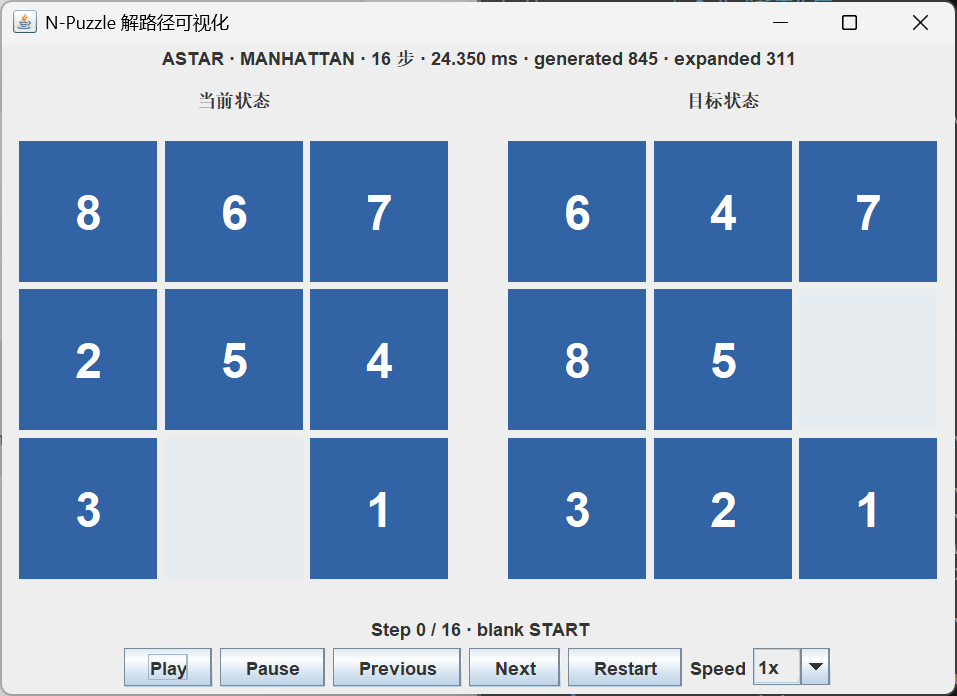

# WattAi · N-Puzzle

人工智能课程实验：在教师提供的 Java 搜索框架上实现 A*、IDA*、加性模式数据库，以及解路径的 Swing 播放器。

[研究报告 PDF](report/latex/main.pdf) · [LaTeX 源码与编译](report/latex/README.md) · [当前实验记录](results/optimization-report-20261108T140641033100Z/) · [实验数据索引](results/INDEX.md)

## 实验目的与要求

实验通过三阶、四阶 N-Puzzle，比较启发式搜索的时间与空间开销，分析候选管理、启发估值、重复状态处理和模式数据库的作用。

| 阶段 | 课程要求 | 本实验的实现与结果 |
| --- | --- | --- |
| 1 | A* 与优先队列在 1 秒内求解指定三阶题 | `PriorityQueue` 与状态索引管理 Open；Manhattan 得到 16 步解，三次求解总耗时均低于 1 秒 |
| 2 | 使用 IDA* 求解四阶题，建议采用 Zobrist 哈希 | 实现 BASIC、TT、ZOBRIST；普通四阶 BASIC IDA* 与 Manhattan 得到 52 步解 |
| 3 | 用不相交模式与 PDB 在 1 分钟内求解指定困难题 | BASIC、fast、555T 得到 70 步解；独立冷启动含建表总耗时 16.981 秒 |
| 4 | 可视化展示解路径，平台不限 | Swing 从 TSV 文件逐步还原三阶、四阶棋盘，支持播放、暂停、前后步、重置和速度切换 |

教师框架与原题保持原样，学生实现和适配代码位于 `src/stud/`。框架对照见[教师代码说明](docs/teacher_compliance.md)。

## 当前实验环境与计时

| 项目 | 配置 |
| --- | --- |
| 处理器 | AMD Ryzen 9 8940HX |
| 系统 | Windows 11 |
| Java | JDK 19.0.2，编译器与运行时均为同一安装目录，编译目标为 Java 19 |
| 最大堆 | `-Xmx1024m` |
| 运行方式 | 每次启动独立 JVM；对照配置各重复三次，困难题独立冷启动单列一次 |
| 时间上限 | 每次 60 秒，包含进程启动与 PDB 准备 |
| 算法与启发函数对照 | A* 或 BASIC IDA*；IDA* 开启 `fast=true`、不使用转置表 |
| PDB 分组 | 三阶 4-4；普通四阶 4-4-4-3；困难题 555T |

**搜索耗时**从调用搜索器计至返回结果，包含启发查询与同步快照记录。**求解总耗时**从启动求解进程前计至进程退出，包含输入、PDB 准备、搜索、路径回放和导出；失败运行计至进程退出或终止回收。

以下时间为三次成功运行各指标的中位数；困难题独立冷启动单列一次运行。普通题的 PDB 每次重新建表，困难题模式对照复用同一份预建缓存。结果对应上述环境，不同机器或 JDK 的运行时间会有差异。

80 次主运行中，74 次成功、3 次内存不足、3 次超时；另有 12 次 fast 与快照交叉对照全部成功。三阶没有超时。普通四阶错位数中，A* 三次均内存不足，IDA* 三次均达到 60 秒上限，其他主实验配置均完成求解。

## 三阶题结果

教师指定状态对为：

```text
初态          目标
8 6 7         6 4 7
2 5 4         8 5 0
3 0 1         3 2 1
```

`0` 表示空位。全部配置得到 16 步合法路径。A* 与 Manhattan 的搜索中位数为 **6.002 ms**，求解总耗时中位数为 **145.389 ms**，三次总耗时的最大值为 **170.231 ms**。

| 算法 | 启发函数 | 完成情况 | 搜索 / ms | 总耗时 / ms | 扩展次数 |
| --- | --- | --- | ---: | ---: | ---: |
| A* | Misplaced | 3/3 成功 | 8.195 | 167.293 | 799 |
| A* | Manhattan | 3/3 成功 | 6.002 | 145.389 | 311 |
| A* | LC | 3/3 成功 | 5.061 | 140.008 | 201 |
| A* | 加性 PDB | 3/3 成功 | 4.326 | 219.227 | 88 |
| IDA* | Misplaced | 3/3 成功 | 23.987 | 178.170 | 2,053 |
| IDA* | Manhattan | 3/3 成功 | 18.828 | 147.158 | 423 |
| IDA* | LC | 3/3 成功 | 19.593 | 171.858 | 259 |
| IDA* | 加性 PDB | 3/3 成功 | 17.328 | 234.436 | 110 |

三阶 PDB 采用 4-4 分组，每次冷建表。LC 表示 Manhattan 加线性冲突修正。

## 普通四阶题结果

题目取 `resources/problems3.txt` 第 4 行，零起索引 3。成功配置均得到 52 步合法路径。

| 算法 | 启发函数 | 完成情况 | 搜索 / ms | 总耗时 / ms | 扩展次数 |
| --- | --- | --- | ---: | ---: | ---: |
| A* | Misplaced | 3/3 内存不足 | — | — | — |
| A* | Manhattan | 3/3 成功 | 685.852 | 857.150 | 339,410 |
| A* | LC | 3/3 成功 | 508.963 | 684.312 | 184,819 |
| A* | 加性 PDB | 3/3 成功 | 282.389 | 743.599 | 118,544 |
| IDA* | Misplaced | 3/3 超时 | — | — | — |
| IDA* | Manhattan | 3/3 成功 | 196.860 | 352.215 | 997,736 |
| IDA* | LC | 3/3 成功 | 364.377 | 528.513 | 595,024 |
| IDA* | 加性 PDB | 3/3 成功 | 138.946 | 585.805 | 275,777 |

Manhattan 下，IDA* 搜索比 A* 更短，但扩展次数更多。LC 使 A* 搜索从 685.852 ms 降至 508.963 ms，IDA* 则从 196.860 ms 升至 364.377 ms。更强的下界减少了扩展，也增加了每次估值的计算。

PDB 采用 4-4-4-3 分组。A* 使用 PDB 后，搜索与总耗时均低于 Manhattan；IDA* 使用 PDB 后，搜索更短，总耗时却因建表而增加。错位数的失败结果单列，不作为完成搜索的时间。

## 教师困难题结果

题目取 `resources/problems3.txt` 第 10 行，零起索引 9：

```text
初态              目标
15 14 13 12       1  2  3  4
11 10  9  8       5  6  7  8
 7  6  5  4       9 10 11 12
 3  1  2  0      13 14 15  0
```

采用 BASIC IDA*、`fast=true` 和 555T 分组：

```text
P1 = {1, 5, 9, 13, 2}
P2 = {6, 10, 14, 3, 7}
P3 = {11, 15, 4, 8, 12}
```

| 缓存条件 | 次数 | 解长 | 建表 / ms | 加载 / ms | 搜索 / ms | 总耗时 / ms |
| --- | ---: | ---: | ---: | ---: | ---: | ---: |
| 独立冷启动 | 1 | 70 | 2985 | 0 | 13816.796 | 16981.279 |
| 热缓存 | 3 | 70 | 0 | 21 | 13564.695 | 13790.780 |

独立冷启动包含建表的总耗时为 **16.981 秒**，满足 1 分钟要求。热缓存三次全部成功，总耗时中位数为 **13.791 秒**。冷启动为单次运行，热缓存各时间列分别取三次运行的中位数。

热缓存下进一步比较转置表容量与 fast 开关：

| 模式 | 转置表容量 | fast | 搜索 / s | 总耗时 / s | 完成情况 |
| --- | ---: | --- | ---: | ---: | --- |
| BASIC | 0 | 关闭 | 19.804 | 20.018 | 3/3 成功 |
| BASIC | 0 | 开启 | 13.565 | 13.791 | 3/3 成功 |
| TT | 100,000 | 开启 | 21.385 | 21.567 | 3/3 成功 |
| TT | 500,000 | 开启 | 24.457 | 24.681 | 3/3 成功 |
| TT | 1,000,000 | 开启 | 24.608 | 24.831 | 3/3 成功 |
| ZOBRIST | 100,000 | 开启 | 14.484 | 14.710 | 3/3 成功 |
| ZOBRIST | 500,000 | 开启 | 21.477 | 21.711 | 3/3 成功 |
| ZOBRIST | 1,000,000 | 开启 | 22.332 | 22.534 | 3/3 成功 |

BASIC 与 fast 的组合在这道题中总耗时最低。转置表减少了重复访问，却增加哈希、判等和存储管理开销；增大容量并未使总耗时持续下降。fast 在创建子状态前过滤立即反向动作，并提前检查路径环、逐个生成后继，减少无效构造与 PDB 查询。

## 算法与实现

- **A***：以 `f=g+h` 排序，Open 使用优先队列与状态索引，Closed 使用状态集合。当前实现不重开 Closed，采用一致启发函数保证最优性。较优重复结点的替换仍需线性删除旧堆项。
- **IDA***：在 `f` 阈值内深度优先搜索，下一轮阈值取最小超界值。BASIC 保存当前路径，TT 与 ZOBRIST 另用有容量上限的转置表；每轮阈值迭代清空表。Zobrist 用于分桶，桶内仍比较完整状态。
- **启发函数**：提供 Misplaced、Manhattan、LC 和加性 PDB。Manhattan、Misplaced 支持单牌增量更新；LC 重新计算距离与冲突；PDB 按抽象状态排名查表。
- **加性 PDB**：每步仅由被移动将牌所属组收费，其他组收费 0，通过 0-1 BFS 建表。

报告给出了算法证明、数据结构、调用关系图和逐项实验分析，详见[报告 PDF](report/latex/main.pdf)。

## 编译与运行

在仓库根目录使用 PowerShell，安装 JDK 19 或更高版本，并使 `java`、`javac` 可从命令行调用。

```powershell
# 编译教师框架、学生实现和测试
.\tools\compile.ps1

# 运行常规测试
.\tools\reproduce.ps1

# 运行 LC、转置表与 fast 的专项正确性测试
java -Xmx1024m -Dwattai.fast=true -cp build-test PuzzleOptimizationTest

# 独立冷启动求解困难题，随后用同一份缓存运行热对照
.\tools\reproduce.ps1 -RunHard -RunWarm
```

构建脚本只在 `build-test` 中生成编码统一的源码副本，编译目标为 Java 19。当前实验记录中九套 Java 测试均通过，所有成功路径都完成了逐步回放。

若要完整重跑报告使用的实验矩阵，需要 Python 3.10 或更高版本：

```powershell
python tools/report_experiments.py --java-home E:\java19
```

`--java-home` 指定 JDK 安装目录，以上使用本机的 `E:\java19`；编译器与全部求解进程均使用该目录下的 JDK。脚本依次执行测试、80 次主运行和 12 次交叉对照，结果写入新的 `results/optimization-report-*` 目录。该命令会重新运行整组实验；只查看已有结果可直接打开[原始记录](results/optimization-report-20261108T140641033100Z/)。

## 路径播放

播放器读取 TSV 解路径文件，支持 Play、Pause、Previous、Next、Restart，以及 0.5x、1x、2x 播放速度。到达首末步后，步号保持在有效范围内。

```powershell
$solutionFile = 'results/optimization-report-20261108T140641033100Z/runs/038-hard_cold-hard-IDA-DISJOINT_PATTERN-BASIC-0-fasttrue-r1/solution.tsv'
java -cp build-test stud.g01.visual.PuzzleVisualizer $solutionFile
```

实际界面如下，图片展示初态与目标状态，性能数据采用前文实验表。

| 状态 | 三阶，16 步 | 困难四阶，70 步 |
| --- | --- | --- |
| 初态 |  |  |
| 目标 |  |  |

## 报告与图表编译

本地安装 XeLaTeX 及宋体、Calibri、Arial 字体后执行：

```powershell
.\report\latex\build.ps1
```

输出为 `report/latex/main.pdf`。修改矢量图源文件后，使用 `-RebuildFigures` 一并编译图形。

实验表格与统计图可由已有原始数据重新生成：

```powershell
python report/latex/section4Tables/build_current_tables.py
.\report\latex\build.ps1 -RebuildFigures
```

当前数据目录由 [current-sources.json](report/latex/section4Tables/current-sources.json) 指定。LaTeX 正文、表格和图形均可编辑；更换数据来源时，需要同步正文中的实验数值与分析。

## 目录与资料

| 目录 | 内容 |
| --- | --- |
| `src/core`、`src/algs4` | 教师框架与原有依赖 |
| `src/stud` | 状态、动作、搜索器、启发函数、兼容适配与播放器 |
| `resources` | 原题与独立命名的教师三阶实例 |
| `tests`、`tools` | 测试、构建、实验运行与图表生成 |
| `results` | 原始运行、环境、配置、路径和统计 |
| `report/latex` | 当前报告源码、图表与 PDF |
| `docs` | 实现说明、教师框架对照与操作记录 |

历史实验和独立旧报告保留原文件，由[结果索引](results/INDEX.md)与[报告说明](report/README.md)导航。第三方代码来源与许可见 [THIRD_PARTY_NOTICES.md](THIRD_PARTY_NOTICES.md)。教师参考材料、构建目录与 PDB 缓存不纳入仓库。
