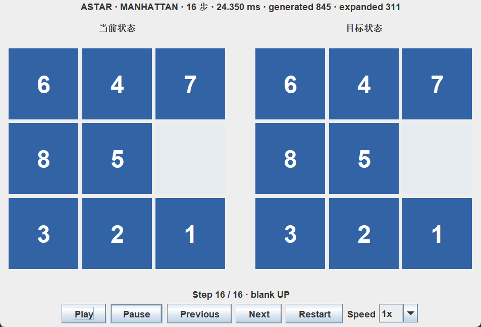
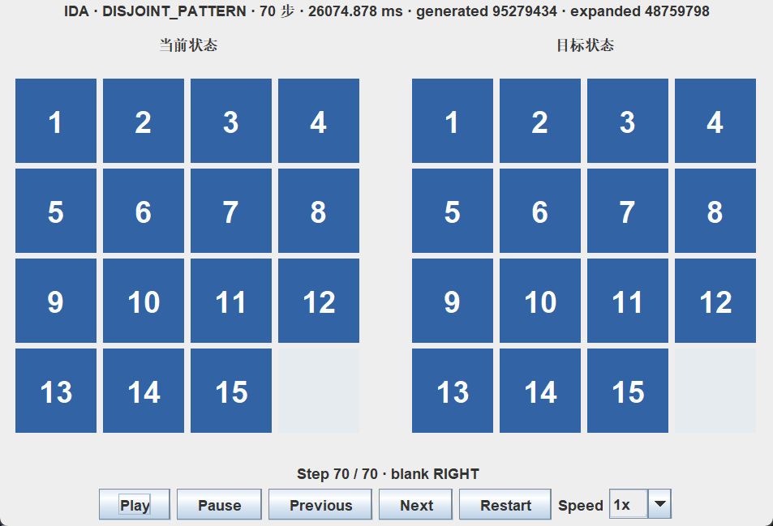

# 1 启发式算法综述

本实验在课程提供的 Java 框架上实现 N-Puzzle 求解与解路径播放。教师指定的 3×3 状态对由 A* 得到最短 16 步解；2026-10-10 最难 15-Puzzle 冷缓存得到 70 步解，父端总时长为 32.594 秒。2026-10-11 独立复核见表 4。本文说明算法、数据结构及四阶段证据。可视化解析与播放状态测试通过，桌面按钮操作仍待人工验收。

## 1.1 算法描述

搜索树结点记录状态、父结点、动作、已付代价 g 和剩余代价估计 h。A* 按 f=g+h 的升序取出候选结点，遇到目标时沿父链恢复路径。优先队列负责快速取得最小估值结点，Open 与 Closed 则共同处理重复状态。评估规则必须与启发函数的性质一起分析，不能把任意最佳优先策略都称为最优 A*。

## 1.2 算法的可采纳性

记 h*(s) 为状态 s 到目标的真实最短代价。可采纳启发函数满足 0≤h(s)≤h*(s)。一致性要求对每条代价为 c 的合法边有 h(s)≤c+h(s′)。前者控制高估，后者保证沿路径 f 不下降；两者作用不同。

### 1.2.1 A* 算法

初始化根结点后，循环从 Open 取出最小 f 的结点。若为目标，返回解；否则生成合法后继，计算 g′ 与 h′，处理相同状态的替换，再进入下一轮。当前实现使用教师 BestFirstSearcher、学生 PqFrontier 和不可变 PuzzleBoard。Closed 是 HashSet，Open 使用 PriorityQueue 加状态索引表。

### 1.2.2 A* 算法可采纳性证明

在目标弹出之前，最优路径上仍存在一个尚未扩展的边界结点，其 f 不超过最优解代价 C*。如果先弹出的目标代价大于 C*，则它不可能是 Open 中的最小 f，产生矛盾。当前教师图搜索不重新打开 Closed，因此还要求启发函数一致；本实验的 Misplaced、Manhattan 和固定加性 PDB 均满足这一条件。此结论不适用于未经证明的不一致启发函数或带权估值。

## 1.3 重复扩展结点的问题

滑块动作可以立即反向，较长动作序列也可能回到同一棋盘。若只按树展开，会重复生成相同子问题；若只用哈希值判断相等，又可能把不同状态误合并。当前状态相等以完整棋盘数组为准，哈希只加速查找。

### 1.3.1 重复扩展结点处理

A* 在 Open 中维护每个状态的一份有效结点，保留较好估值，Closed 保存已扩展状态。IDA* 必须在每一轮阈值搜索开始时清空转置记录，当前路径集合只拒绝环。Zobrist 模式使用 64 位值选择桶，再用完整状态相等确认剪枝；故意同哈希的图测试用于验证这一点。

### 1.3.2 启发函数的单调性

当 h 一致时，f(s′)=g(s)+c+h(s′)≥g(s)+h(s)=f(s)。因此最小 f 顺序取出的状态无需因更短路径重新打开。两个一致启发函数取 max 仍一致；两个含重叠成本的下界直接相加则可能失去可采纳性，不能以更大 h 为理由使用。

## 1.4 IDA* 基本原理及其可采纳性

IDA* 用深度优先搜索限制 f≤bound，初始 bound=h(initial)。本轮无解时，将下一轮阈值设为本轮超界 f 的最小值，而不是机械地加一。单位正代价和可采纳 h 保证：到达最优代价阈值前不会返回更昂贵解，最优路径也不会被估值剪掉。删除路径环不会丢失最短解，因为正代价环可以去掉。

IDA* 的路径存储随深度增长，不保存 A* 的整个 Open，但跨轮重复扩展会增加时间。TT/Zobrist 缓存还会额外占用内存，其安全性受每轮重置、完整状态比较和较优 g 处理约束。本实验对 BASIC、TT、ZOBRIST 做有限最短距离和碰撞回归；hard 推荐使用 BASIC，以免将小规模缓存验证扩大成任意图的普遍证明。

# 2 N-Puzzle 游戏与模型

## 2.1 N-Puzzle 游戏描述

棋盘为 n×n，包含 1 到 n²−1 的将牌与一个空位。每一步将空位与上下左右的相邻将牌交换，动作代价为 1。目标既可以是标准顺序，也可以是输入给出的任意合法排列。评价结果必须使用该题自己的目标；本实验不会默认所有题都以标准排列为目标。

## 2.2 状态空间与转换规则

PuzzleBoard 用行优先 int[] 记录完整排列，构造时验证长度、范围和唯一性；内部数组不向外暴露。next() 仅执行合法相邻交换，返回新对象，并更新空位位置与哈希。理论排列数为 (n²)!，对于 3×3/4×4 的正常移动规则，可达类各占一半。完整枚举适合 8-Puzzle 的正确性测试，15-Puzzle 不适合直接全空间搜索。

## 2.3 N-Puzzle 可解性研究

对奇数边长，忽略空位后的逆序数奇偶是连通类不变量；对偶数边长，逆序数奇偶与空位从底部起的行号奇偶之和保持不变。因此比较初态和目标的同一不变量即可判断是否属于同一可达类。该规则适用于本项目 3×3/4×4；不能将 1×n 等退化图一概代入。测试包含任意目标及交换两枚将牌形成的无解状态。

## 2.4 三个启发函数的有效性与单调性

### 2.4.1 曼哈顿距离

把每枚非空将牌当前位置与目标位置的行列距离相加。一次合法移动只改变一枚将牌的一格距离，因此 h 的减少量不超过 1；要完成所有位置修正至少需要该总距离，故可采纳且一致。计算目标索引时使用输入目标，而不依赖将牌编号排列。

### 2.4.2 不在位将牌

统计不在自身目标位置的非空将牌数，空位不计入。每一步至多使一枚将牌归位，故是真实步数下界；一次移动至多使估计减少 1，故一致。计算便宜，但没有考虑将牌与目标相距多远，通常比 Manhattan 弱。本轮普通 4×4 的超时体现了这一不足，而不是无解。

### 2.4.3 Disjoint Pattern

将所有非空将牌分入互不重叠的组。每个抽象状态保留空位及本组将牌位置，其余将牌不可区分。真实一步只对包含被移动将牌的组计成本 1，对其余组计成本 0。对任意真实解，各组抽象最短距离分别不超过该解在该组分摊的成本；求和后不超过真实解总成本。因此加性 PDB 可采纳。每组的最短距离满足对应边的三角不等式，组成本和为 1，故求和也一致。

空位出现在每一张表中用于描述合法转移，但不重复分摊成本。若用普通 unit-cost BFS 把每组的所有空位交换都计 1，再求和，就可能重复计费；当前 PatternTable 使用 0-1 BFS。5-5-5 与转置的 555T 是两种完整分组，互相之间有将牌重叠，最多取 max，不能把两套结果相加。

# 3 N-Puzzle 求解算法实现

## 3.1 状态及结点的数据结构

状态对象保存排列、空位、缓存哈希与按需位置索引。结点保存状态、父链、动作、g 和 h。不可变状态适合作为 HashMap/HashSet 的键，也便于验证父状态不会因子结点搜索被破坏。代价是每次交换仍需分配数组与状态对象，hard 的大规模展开仍有分配成本。

## 3.2 Open 与 Closed 的数据结构

学生 PqFrontier 使用 java.util.PriorityQueue，offer/poll 的堆操作通常为 O(log N)，状态索引 byState 的查询平均为 O(1)。遇到较好重复结点时调用 PriorityQueue.remove(oldNode)，这一步是线性查找，因此不能把所有队列操作都写成 O(log N)。相比排序列表，它避免每次线性查找最小值；但还需要状态索引，A* 的存储会随已发现结点增长。

教师 BestFirstSearcher 与核心契约按原文件字节恢复；不能为了接口方便修改 final 方法。原 EngineFeeder 引用缺失的 stud.solver.IdAStar，新增学生适配器委托给已验证的 stud.g01 实现。增量预测接口和线性冲突枚举放入 stud/g01/heuristic；学生 StudentSearchTester 负责第二阶段路由，教师测试入口保持原样。

## 3.3 三个启发函数的具体实现

### 3.3.1 曼哈顿距离实现

目标位置映射避免为每枚将牌重复扫描整个目标。学生 IncrementalPredictor 在 IDA* fast 分支中只更新被移动将牌的贡献；随机走动后与全量重算对照，确认两者相等。恢复教师 Problem 后，普通框架 A* 按原方法全量估值；本轮 A* 的新测量包含这个代价。

### 3.3.2 不在位将牌实现

遍历非空将牌并比较目标位置。增量更新通过交换前后被移动将牌是否在位来修正父 h，空位保持不计数。由于变化局部，计算简单；但弱启发产生的额外节点可能远超过省下的估值时间。

### 3.3.3 Disjoint Pattern 与 Pattern Database

PatternTable 按有序位置的部分排列排名，状态数为 P(cells, patternSize+1)，额外的一项为空位。排名逐项计算尚未占用位置中的次序，用位掩码与 bitCount 计算已用位置数量；value() 利用棋盘位置索引直接取得本组位置，不产生临时位置数组。构建从抽象目标出发，零成本边放双端队列头，一成本边放尾。

缓存头包含 PDB1 魔数、版本、成本划分、棋盘大小、分组与目标位置；后面是距离数量、CRC32 与距离字节。加载核对这些字段和文件尾，损坏缓存重建。hard 的 555T 为 {1,5,9,13,2}、{6,10,14,3,7}、{11,15,4,8,12}。每张表有 5,765,760 个状态，三表共 17,297,280 个距离字节；文件总大小为 17,297,496 字节。这是表文件占用，不能解释为 JVM 峰值内存。

## 3.4 后继生成与三阶段改进

第一阶段完成合法动作、任意目标启发与真正的优先队列，使 3×3 A* 可正确求解。第二阶段使用 f 阈值 IDA*，加入路径去环、每轮转置表和完整状态碰撞处理，降低需要存储的 Open 规模。第三阶段用加性 PDB 提升下界，并在学生 fast 分支中提前过滤立即反向动作、逐个生成子状态、利用已有位置索引。

fast 分支只用于确切的 NPuzzleProblem 类型，以免绕开其他问题子类自定义的动作代价与 applicable 规则。它仍保留完整当前路径去环；过滤反向动作不是替代全部环检测。回归对 fast 与普通分支比较最短解、阈值序列、展开节点和状态不变性，hard 则通过原题完整回放确认。

# 4 实验结果与讨论

## 4.1 环境与可复现实验协议

本轮使用 Java 19（--release 19 编译），系统为 Microsoft Windows NT 10.0.26200.0，处理器为 Intel(R) Core(TM) i5-14500HX，每个搜索工作 JVM 使用 -Xmx1024m。源码版本基于 5eb6e5f4b848 的工作分支；实际修改版本由每个运行目录的 source-manifest.json 逐文件 SHA-256 定义，不能将基线提交号冒充修改后的代码版本。

3×3 对照共六种算法/启发组合，每组独立新 JVM 运行三次，没有预热同一个 JVM，JIT 成本包含在各自搜索计时中。PDB 每次使用新缓存目录，建表时间单列。普通 4×4 对照使用 problems3.txt 零起索引 3，每组一次、父端限制 10 秒。对照 CSV 中 teacher4 是该数据集标签，不意味着教师文档另指定了一个该棋盘图。hard 使用索引 9、60 秒工作进程限制，并验证实际父端总时长。

elapsed_ms 是工作 JVM 内搜索区间；pdb_build_ms 与 pdb_load_ms 是表准备时间；父端 end_to_end_ms 从创建工作 JVM 前开始，包含工作 JVM 启动、准备、搜索、回放、导出及结果收集。父 JVM 自身首次启动未单独计时；父端与搜索的差值还含读入、准备、回放等，不能解释成纯 JVM 启动时间。TIMEOUT/OOM/FAIL 行保留为空的搜索指标，不拿上限值当成功搜索耗时，也不加入成功耗时中位数。

## 4.2 A* 与 IDA* 性能比较

表 1 教师 3×3 同题独立 JVM 三次实验

| 算法 | 启发函数 | 步数 | 搜索中位 ms | 扩展数 | 父端中位 ms |
| --- | --- | --- | --- | --- | --- |
| ASTAR | MISPLACED | 16 | 23.750 | 799 | 274.710 |
| ASTAR | MANHATTAN | 16 | 24.350 | 311 | 292.253 |
| ASTAR | DISJOINT_PATTERN | 16 | 21.692 | 88 | 470.573 |
| IDA | MISPLACED | 16 | 134.892 | 2053 | 377.755 |
| IDA | MANHATTAN | 16 | 121.195 | 423 | 392.245 |
| IDA | DISJOINT_PATTERN | 16 | 107.974 | 110 | 548.742 |

初态为 8 6 7 / 2 5 4 / 3 0 1，目标为 6 4 7 / 8 5 0 / 3 2 1。独立 BFS 的最短距离为 16，所有 A*/IDA* 导出路径均合法并到达相同目标。A* Misplaced 与 Manhattan 的最大搜索耗时分别为 27.430 ms 和 28.752 ms；三个 A* 组合的全部父端记录也低于 1 秒，达成本机教师实例要求。

IDA* 在该小题的搜索时间高于 A*，尽管 Manhattan 的 generated 更少；每轮阈值重启、冷 JVM 编译与递归操作都会影响实际成本。三次重复不足以作统计显著性判断。PDB 的扩展数最少，但准备表又增加父端时间，不能只据节点数宣布全面最快。

## 4.3 三种启发函数与普通 15-Puzzle 对照

表 2 problems3.txt 索引 3 同题 4×4 对照 单次 10 秒上限

| 算法 | 启发函数 | 状态 | 步数 | 搜索 ms | 扩展数 | 父端 ms |
| --- | --- | --- | --- | --- | --- | --- |
| ASTAR | MISPLACED | TIMEOUT | - | - | - | 10140.2 |
| ASTAR | MANHATTAN | SOLVED | 52 | 1031.040 | 339410 | 1330.2 |
| ASTAR | DISJOINT_PATTERN | SOLVED | 52 | 406.016 | 118544 | 1250.8 |
| IDA | MISPLACED | TIMEOUT | - | - | - | 10060.6 |
| IDA | MANHATTAN | SOLVED | 52 | 435.977 | 997736 | 694.1 |
| IDA | DISJOINT_PATTERN | SOLVED | 52 | 370.395 | 275777 | 1221.1 |

### 4.3.1 运行时间比较及分析

成功配置均得到 52 步且完整回放一致。Manhattan IDA* 在本次单运行中比 Manhattan A* 更快；PDB A* 的搜索耗时显著下降，但冷建表消耗约 0.56 秒，父端总时长与 Manhattan A* 接近。PDB IDA* 搜索小幅下降，父端却高于 Manhattan IDA*。这些是当前题、当前环境和单次测量的结果，不足以证明所有 15-Puzzle 都有相同排序。

### 4.3.2 扩展结点比较及分析

同题 Manhattan A* 扩展 339,410 个结点，PDB A* 扩展 118,544 个；Manhattan IDA* 扩展 997,736 个，PDB IDA* 扩展 275,777 个。PDB 提升下界后减少了实际展开，但一次查表的成本与一次计算 Manhattan 不同。fast IDA* 在生成前过滤反向动作，因此 generated 与框架 A* 的计数口径不同；expanded 的算法含义也包括 IDA* 跨轮重复，不能当作唯一状态数。

## 4.4 最难实例的独立冷热验收

表 3 hard 原题 BASIC 555T fast=true -Xmx1024m 60 秒限制

| 缓存 | 状态 | 步数 | 建表 ms | 加载 ms | 搜索 ms | 父端总 ms |
| --- | --- | --- | --- | --- | --- | --- |
| 冷缓存 | SOLVED | 70 | 6192 | 0 | 26074.878 | 32593.8569 |
| 热缓存 | SOLVED | 70 | 0 | 40 | 27863.430 | 28186.2268 |

题目为 problems3.txt 第 10 行：初态 15 14 13 12 / 11 10 9 8 / 7 6 5 4 / 3 2 1 0，目标采用该行原始标准目标。冷运行初始 h=56，阈值序列为 [56, 58, 60, 62, 64, 66, 68, 70]，展开 48,759,798、生成 95,279,434，PDB 估值调用 95,278,467。BASIC 的转置表占用为 0；搜索最大非目标深度记录 69，对应完整解长 70。

冷运行回放 0.081 ms，导出 15.005 ms。父端总时长 32.594 秒小于 60 秒，保守口径达标。热运行未建库，加载 40 ms；热搜索稍慢而父端更短，说明系统/JIT/GC波动和准备成本都需要分开看。本轮不再据这两次结果做无界调参。

表 3 是 2026-10-10 的实测结果。2026-10-09 的 34.0966172 秒冷运行是历史证据，已独立回放核对。第一次迁移后冷运行也成功（父端 33.0538807 秒），但复现脚本在读取 java -version 的 stderr 时失败；这条失败入口记录保留。更早的 4443、旧 555、TT 矩阵 TIMEOUT 与 OOM 保留原始依据，不同版本与限时不能直接比较。

表 4 2026-10-11 干净构建的独立 hard 复现

| 缓存 | 状态 | 步数 | 建表 ms | 加载 ms | 搜索 ms | 父端总 ms |
| --- | --- | --- | --- | --- | --- | --- |
| 冷缓存 | SOLVED | 70 | 4819 | 0 | 17708.691 | 22729.4068 |
| 热缓存 | SOLVED | 70 | 0 | 29 | 20069.836 | 20301.7694 |

最终整理后，从不含教师参考目录、未跟踪工具、构建产物和既有缓存的源码快照重新编译。JDK 19、-Xmx1024m、BASIC、555T、fast=true 和 60 秒条件保持不变；冷缓存目录事先不存在。两条完整路径均通过题目身份、合法动作、目标及父端时限门禁。此次搜索源码与表 3 相同，展开数和阈值序列也相同；耗时下降可能来自系统、JIT、GC和运行负载波动，不能归因于目录精简或宣称算法改进。原始 CSV、环境、源码哈希、计时和完整路径保留于 data_sources.json 与 results/INDEX.md。

## 4.5 补充实验与证据限制

历史 pdb_bfs_bibfs_benchmark.csv 对比 unit-cost 抽象图的单点查询：BiBFS 从两端减少查询展开，并非一次生成完整加性模式数据库。另有 additive-build-20261009T055706988422Z/complete-build.csv，对 3×3 相同 0/1 成本输出逐状态距离做全量比较；这里的 BiBFS 是逐点拼出整张表，不能据单点更快推断完整建库更快。本轮没有为增加数据量重新跑这些补充实验。

frontier/random 历史 CSV 保留固定 seed，版本与计时口径不同，作为补充，不与正文对照混算。visited、frontier、TT 条目、当前 heap_used_bytes 及 PDB 文件大小都不是 JVM 峰值内存；GC/JIT 快照仅描述运行过程。

# 5 解路径可视化

## 5.1 文件格式与加载验证

求解器导出 NPUZZLE_SOLUTION_V1 TSV，前九行描述算法、启发、规模、搜索时间、生成/展开数、解长和目标；随后逐步给出动作与状态，首步为 START。SolutionTrace 校验元数据、排列、序号、每步动作合法性、状态连续性和最终目标。支持 3×3/4×4，损坏或不完整路径报错后退出，不展示伪造棋盘。

## 5.2 Swing 界面与关键逻辑

Swing 窗口左右显示当前棋盘与目标，顶部显示指标，底部显示步号及 Play、Pause、Previous、Next、Restart 与速度选择。PlaybackModel 将步号、播放状态与 1400/700/350 ms 三档延时从窗口中分离；javax.swing.Timer 在事件线程推进，末步自动暂停，Previous/Next/Restart 同时停止计时器，避免越界。

加载路径发生在显示窗口之前，事件线程只做轻量绘制。每次刷新重建棋盘标签并 revalidate/repaint。0 显示为空格，4×4 使用较小字号与格子。速度切换只改变后续 tick 的延迟，状态本身不依赖墙钟，因此可以自动测零步、末步和暂停时 tick 等边界。

## 5.3 自动验证与人工验收

2026-10-10 自动验证了 55 份真实 TSV，覆盖教师 16 步、普通 52 步和 hard 70 步。最终整理移除部分无独立引用的重复成功路径，保留 CSV 所需路径，并重新回放全部保留路径。Closeout 测试覆盖播放边界、速度、暂停及损坏输入；它说明解析与状态逻辑正确，不能代替鼠标操作和视觉体验的验收。已有两张用户本机真实 Swing 终态截图；按钮及速度逐项人工验收仍为 MANUAL_GUI_PENDING，步骤见 docs/acceptance.md。

## 5.4 本机真实终态截图

两图保持用户提供的原始 PNG 字节。当前棋盘与目标一致，分别处于 16/16 和 70/70 步；终态图只能支持显示及终态一致性，不能据此宣称 Play、Pause、Previous、Next、Restart 与速度切换已经人工验收。

图 1 教师指定 3×3 的本机 Swing 终态

图 2 最难 4×4 的本机 Swing 终态

# 6 总结及展望

四阶段的自动工作已形成可重复的构建、搜索、路径和实验链：A* 满足指定 3×3 的时限，IDA* 提供适合更大棋盘的内存取舍，555T 加性 PDB 保持 hard 的 70 步与冷启动达标，Swing 具备严格文件驱动播放。恢复教师文件后，成功方案没有出现实测性能退化。

仍需填写封面、人工操作 GUI，并按课程流程提交。当前结果只覆盖规定实例与有限对照，不能推广为全部 15-Puzzle 都在一分钟内求解。若以后确有性能需求，可先测 PriorityQueue 重复替换、状态数组分配与 PDB 查询的真实成本，再作单因素实验；本轮已达标，不继续盲目扩大表或替换算法。

# 参考文献

[1] Hart P E, Nilsson N J, Raphael B. A Formal Basis for the Heuristic Determination of Minimum Cost Paths. IEEE Transactions on Systems Science and Cybernetics, 1968, 4(2):100-107. DOI:10.1109/TSSC.1968.300136. 原文：https://www.cs.auckland.ac.nz/courses/compsci709s2c/resources/Mike.d/astarNilsson.pdf

[2] Korf R E. Depth-first iterative-deepening: An optimal admissible tree search. Artificial Intelligence, 1985, 27(1):97-109. DOI:10.1016/0004-3702(85)90084-0. 出版社：https://www.sciencedirect.com/science/article/abs/pii/0004370285900840

[3] Felner A, Korf R E, Hanan S. Additive Pattern Database Heuristics. Journal of Artificial Intelligence Research, 2004, 22:279-318. DOI:10.1613/jair.1480. 原文：https://s.aaai.org/Papers/JAIR/Vol22/JAIR-2209.pdf

[4] 课程材料：《NPuzzle求解的要求》《NPuzzle求解研究报告》《分工建议》《项目一讲解》。本地 teacher_reference/ 只读保留，未随仓库发布。

[5] 本项目原始实验：report/data_sources.json 列出的 CSV、parent.txt、timings.properties、TSV 及源码哈希清单，2026-10-10 与 2026-10-11。

# 附录 复现与证据入口

在 Windows PowerShell 中执行 powershell -NoProfile -ExecutionPolicy Bypass -File tools/reproduce.ps1 -RunHard -RunWarm。编译与六套原有测试、教师回归、失败状态拒绝测试全部完成后，脚本以独立冷缓存验收 hard；未 SOLVED、路径错误或实际父端超时均非零结束。tools/compare.ps1 复现同题对照，会使用新的输出目录，保留所有失败。

报告数据源为 report/data_sources.json；最终导航为 results/INDEX.md；保护文件哈希清单为 results/submission-20261010/teacher-protected-files.csv；验收为 docs/acceptance.md；重要变更与回退依据为 docs/changes.md。报告正文由 tools/build_report.py 生成，可编辑 DOCX 经 Word 更新目录、导出 PDF 并逐页检查。
