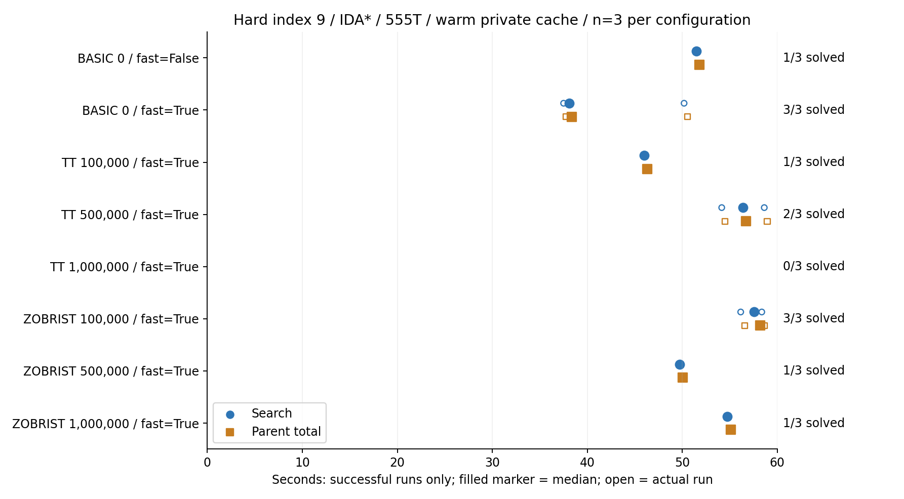
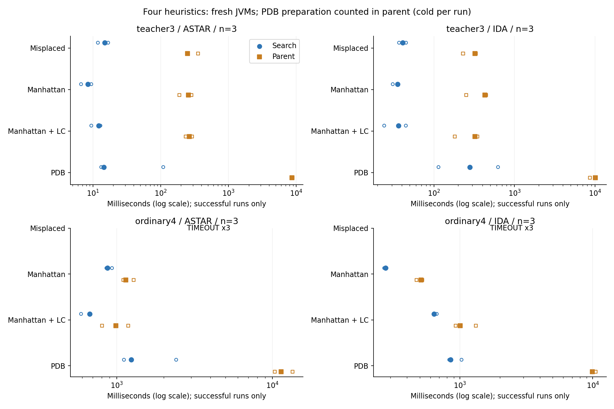
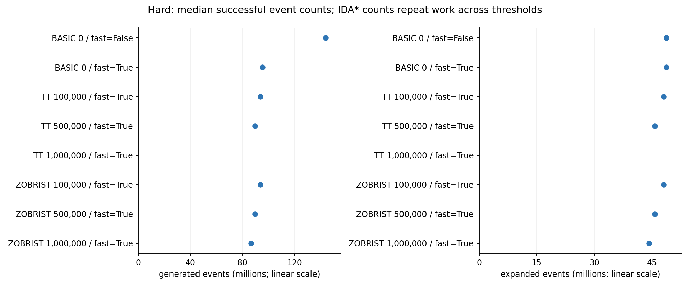

# 新一轮优化实验自动汇总

原始记录位于相邻 runs/，每行代表一次独立工作 JVM；仅 SOLVED 计算中位数。缺失不填零，TIMEOUT 不用截止时长替代搜索耗时。min/max 是观察范围，不是置信区间。

## Hard 模式与容量（同一索引9，555T，热缓存）

| 模式 | 容量 | fast | 成功 | 次数 | 状态 | 搜索中位 ms | 父端中位 ms | 扩展 | TT剪枝 |
| --- | --- | --- | --- | --- | --- | --- | --- | --- | --- |
| BASIC | 0 | False | 1 | 3 | TIMEOUT:2, SOLVED:1 | 51484.857 | 51779.36 | 48759798 | 0 |
| BASIC | 0 | True | 3 | 3 | SOLVED:3 | 38117.937 | 38367.485 | 48759798 | 0 |
| TT | 100000 | True | 1 | 3 | TIMEOUT:2, SOLVED:1 | 45968.237 | 46334.726 | 48057311 | 38159 |
| TT | 500000 | True | 2 | 3 | SOLVED:2, TIMEOUT:1 | 56397.268 | 56714.431 | 45772716 | 150331 |
| TT | 1000000 | True | 0 | 3 | TIMEOUT:3 | 缺失 | 缺失 | 缺失 | 缺失 |
| ZOBRIST | 100000 | True | 3 | 3 | SOLVED:3 | 57564.528 | 58204.382 | 48057311 | 38159 |
| ZOBRIST | 500000 | True | 1 | 3 | TIMEOUT:2, SOLVED:1 | 49740.503 | 50057.686 | 45772716 | 150331 |
| ZOBRIST | 1000000 | True | 1 | 3 | TIMEOUT:2, SOLVED:1 | 54745.451 | 55095.456 | 44243216 | 253939 |

## fast 对照（BASIC，同源同题同缓存）

| fast | 状态 | 搜索中位 ms | 父端中位 ms | 生成 | 扩展 | 路径剪枝 | 反向过滤 | 子状态构造 | 子结点构造 | PDB查询 |
| --- | --- | --- | --- | --- | --- | --- | --- | --- | --- | --- |
| False | TIMEOUT:2, SOLVED:1 | 51484.857 | 51779.36 | 144039191 | 48759798 | 48760725 | 0 | 144039277 | 144039277 | 144039278 |
| True | SOLVED:3 | 38117.937 | 38367.485 | 95279434 | 48759798 | 48760725 | 48759757 | 95279434 | 95278466 | 95278467 |

反向过滤、路径集合提前检查、逐个创建子结点、增量估值属于 fast 组合开关，没有单因素消融。子对象构造计数对应明确构造调用，不是分配字节或峰值内存。DISJOINT_PATTERN 不实现 IncrementalPredictor，所以 Hard 这组不能归因于增量启发值。

## 四启发函数（两个题目、两个算法、每组3次；PDB每次独立冷建表）

| 题目 | 算法 | 启发函数 | 状态 | 解长 | 搜索中位 ms | 父端中位 ms | 生成 | 扩展 | 迭代 | 建表 ms | 加载 ms |
| --- | --- | --- | --- | --- | --- | --- | --- | --- | --- | --- | --- |
| ordinary4 | ASTAR | DISJOINT_PATTERN | SOLVED:3 | 52 | 1236.689 | 11405.114 | 357843 | 118544 | 缺失 | 9218 | 0 |
| ordinary4 | ASTAR | MANHATTAN | SOLVED:3 | 52 | 869.637 | 1142.742 | 1010304 | 339410 | 缺失 | 0 | 0 |
| ordinary4 | ASTAR | MANHATTAN_LC | SOLVED:3 | 52 | 671.068 | 984.741 | 553005 | 184819 | 缺失 | 0 | 0 |
| ordinary4 | ASTAR | MISPLACED | TIMEOUT:3 | 缺失 | 缺失 | 缺失 | 缺失 | 缺失 | 缺失 | 缺失 | 缺失 |
| ordinary4 | IDA | DISJOINT_PATTERN | SOLVED:3 | 52 | 853.23 | 9931.605 | 560808 | 275777 | 5 | 8777 | 0 |
| ordinary4 | IDA | MANHATTAN | SOLVED:3 | 52 | 275.604 | 510.372 | 2007071 | 997736 | 5 | 0 | 0 |
| ordinary4 | IDA | MANHATTAN_LC | SOLVED:3 | 52 | 639.747 | 1007.668 | 1206726 | 595024 | 5 | 0 | 0 |
| ordinary4 | IDA | MISPLACED | TIMEOUT:3 | 缺失 | 缺失 | 缺失 | 缺失 | 缺失 | 缺失 | 缺失 | 缺失 |
| teacher3 | ASTAR | DISJOINT_PATTERN | SOLVED:3 | 16 | 14.45 | 8660.064 | 243 | 88 | 缺失 | 8205 | 0 |
| teacher3 | ASTAR | MANHATTAN | SOLVED:3 | 16 | 8.44 | 257.587 | 845 | 311 | 缺失 | 0 | 0 |
| teacher3 | ASTAR | MANHATTAN_LC | SOLVED:3 | 16 | 12.149 | 265.405 | 544 | 201 | 缺失 | 0 | 0 |
| teacher3 | ASTAR | MISPLACED | SOLVED:3 | 16 | 14.884 | 249.81 | 2169 | 799 | 缺失 | 0 | 0 |
| teacher3 | IDA | DISJOINT_PATTERN | SOLVED:3 | 16 | 278.555 | 10078.56 | 193 | 110 | 4 | 8431 | 0 |
| teacher3 | IDA | MANHATTAN | SOLVED:3 | 16 | 35.363 | 430.205 | 731 | 423 | 6 | 0 | 0 |
| teacher3 | IDA | MANHATTAN_LC | SOLVED:3 | 16 | 36.407 | 322.29 | 452 | 259 | 6 | 0 | 0 |
| teacher3 | IDA | MISPLACED | SOLVED:3 | 16 | 41.02 | 322.009 | 3635 | 2053 | 12 | 0 | 0 |

## 成功率与失败

| 组 | 题 | 算法 | 启发 | 模式 | 容量 | fast | 缓存 | 成功 | 次数 | 状态 |
| --- | --- | --- | --- | --- | --- | --- | --- | --- | --- | --- |
| hard | hard | IDA | DISJOINT_PATTERN | BASIC | 0 | False | warm | 1 | 3 | TIMEOUT:2, SOLVED:1 |
| hard | hard | IDA | DISJOINT_PATTERN | BASIC | 0 | True | warm | 3 | 3 | SOLVED:3 |
| hard | hard | IDA | DISJOINT_PATTERN | TT | 100000 | True | warm | 1 | 3 | TIMEOUT:2, SOLVED:1 |
| hard | hard | IDA | DISJOINT_PATTERN | TT | 500000 | True | warm | 2 | 3 | SOLVED:2, TIMEOUT:1 |
| hard | hard | IDA | DISJOINT_PATTERN | TT | 1000000 | True | warm | 0 | 3 | TIMEOUT:3 |
| hard | hard | IDA | DISJOINT_PATTERN | ZOBRIST | 100000 | True | warm | 3 | 3 | SOLVED:3 |
| hard | hard | IDA | DISJOINT_PATTERN | ZOBRIST | 500000 | True | warm | 1 | 3 | TIMEOUT:2, SOLVED:1 |
| hard | hard | IDA | DISJOINT_PATTERN | ZOBRIST | 1000000 | True | warm | 1 | 3 | TIMEOUT:2, SOLVED:1 |
| hard_cold | hard | IDA | DISJOINT_PATTERN | BASIC | 0 | True | cold | 0 | 1 | TIMEOUT:1 |
| heuristic | ordinary4 | ASTAR | DISJOINT_PATTERN | BASIC | 0 | True | cold | 3 | 3 | SOLVED:3 |
| heuristic | ordinary4 | ASTAR | MANHATTAN | BASIC | 0 | True | not_applicable | 3 | 3 | SOLVED:3 |
| heuristic | ordinary4 | ASTAR | MANHATTAN_LC | BASIC | 0 | True | not_applicable | 3 | 3 | SOLVED:3 |
| heuristic | ordinary4 | ASTAR | MISPLACED | BASIC | 0 | True | not_applicable | 0 | 3 | TIMEOUT:3 |
| heuristic | ordinary4 | IDA | DISJOINT_PATTERN | BASIC | 0 | True | cold | 3 | 3 | SOLVED:3 |
| heuristic | ordinary4 | IDA | MANHATTAN | BASIC | 0 | True | not_applicable | 3 | 3 | SOLVED:3 |
| heuristic | ordinary4 | IDA | MANHATTAN_LC | BASIC | 0 | True | not_applicable | 3 | 3 | SOLVED:3 |
| heuristic | ordinary4 | IDA | MISPLACED | BASIC | 0 | True | not_applicable | 0 | 3 | TIMEOUT:3 |
| heuristic | teacher3 | ASTAR | DISJOINT_PATTERN | BASIC | 0 | True | cold | 3 | 3 | SOLVED:3 |
| heuristic | teacher3 | ASTAR | MANHATTAN | BASIC | 0 | True | not_applicable | 3 | 3 | SOLVED:3 |
| heuristic | teacher3 | ASTAR | MANHATTAN_LC | BASIC | 0 | True | not_applicable | 3 | 3 | SOLVED:3 |
| heuristic | teacher3 | ASTAR | MISPLACED | BASIC | 0 | True | not_applicable | 3 | 3 | SOLVED:3 |
| heuristic | teacher3 | IDA | DISJOINT_PATTERN | BASIC | 0 | True | cold | 3 | 3 | SOLVED:3 |
| heuristic | teacher3 | IDA | MANHATTAN | BASIC | 0 | True | not_applicable | 3 | 3 | SOLVED:3 |
| heuristic | teacher3 | IDA | MANHATTAN_LC | BASIC | 0 | True | not_applicable | 3 | 3 | SOLVED:3 |
| heuristic | teacher3 | IDA | MISPLACED | BASIC | 0 | True | not_applicable | 3 | 3 | SOLVED:3 |
| preflight | preflight | IDA | DISJOINT_PATTERN | BASIC | 0 | True | cold | 1 | 1 | SOLVED:1 |
| preflight | preflight | IDA | DISJOINT_PATTERN | TT | 100000 | True | warm | 1 | 1 | SOLVED:1 |
| preflight | preflight | IDA | DISJOINT_PATTERN | TT | 500000 | True | warm | 1 | 1 | SOLVED:1 |
| preflight | preflight | IDA | DISJOINT_PATTERN | TT | 1000000 | True | warm | 1 | 1 | SOLVED:1 |
| preflight | preflight | IDA | DISJOINT_PATTERN | ZOBRIST | 100000 | True | warm | 1 | 1 | SOLVED:1 |
| preflight | preflight | IDA | DISJOINT_PATTERN | ZOBRIST | 500000 | True | warm | 1 | 1 | SOLVED:1 |
| preflight | preflight | IDA | DISJOINT_PATTERN | ZOBRIST | 1000000 | True | warm | 1 | 1 | SOLVED:1 |

按预先写入分析代码的保守规则，本题热缓存候选为 BASIC / limit=0 / fast=true。该规则要求替换方案3次全成功，父端中位数至少改善10%；阈值是工程选择标准，不是统计显著性。冷缓存只测 BASIC 一次，不能替其他模式证明冷启动验收。

查询次数不能证明 PDB 是主要耗时，独立JFR采样另见 diagnostics/，采样比例不是精确墙钟时间占比。三次固定实例重复不足以推广至全部15-Puzzle。

